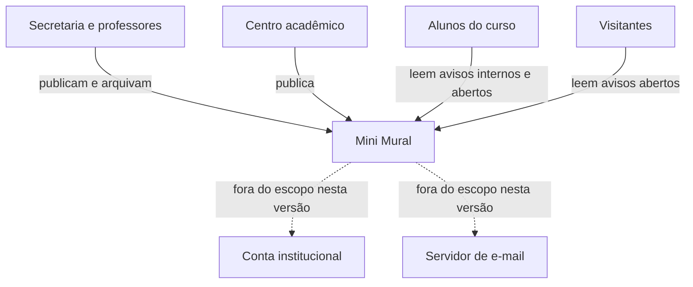

# Descoberta do problema

Resultado do encontro 4. As fontes estão em `descoberta/`, uma ata por
conversa, e cada afirmação deste documento aponta para a fonte de onde veio.

> As entrevistas e a observação deste projeto são simuladas, como a equipe
> (ver `ROTEIRO.md`). O documento segue o formato que um projeto real teria, e
> cada código de fonte leva a uma ata que declara ser simulada.

## Problema

Os avisos do curso chegam aos alunos por três canais separados: e-mail
institucional, grupos de mensagem de turma e mural de papel. Quem saiu de um
grupo, ou lê pouco o e-mail, perde o aviso [E1, E2, E4]. Aviso repassado chega
alterado e sem autor [E2, E5]. Aviso vencido continua no mural de papel [O1,
E4]. E quem publica só descobre que o aviso não chegou quando alguém pergunta no
balcão: em uma hora de observação, 3 de 7 atendimentos foram sobre algo já
avisado [E1, O1].

## Partes interessadas

| Parte | Categoria | Interesse | Poder | Contato (quem da equipe, e como) |
|---|---|---|---|---|
| Coordenação do curso | Decide | Avisos de prazo corretos e regra clara sobre quem publica | Alto | Eva, por meio da secretaria; conversa a agendar |
| Secretaria da coordenação | Usa | Publicar uma vez e parar o atendimento repetido | Médio | Eva, presencial (E1, O1) |
| Professores | Usam | Publicar e retirar os próprios avisos sem depender de ninguém | Médio | Davi, ao fim da aula (E2) |
| Centro acadêmico | Usa | Alcançar quem não é do curso | Baixo | Carla, na sala do centro acadêmico (E3) |
| Alunos do curso | Usam e são afetados | Saber o que vale agora, com autor e data | Baixo | Bruno, nos intervalos (E4, E5) |
| Visitantes e calouros | São afetados | Ler avisos abertos sem criar conta | Baixo | Carla, por meio do centro acadêmico; ninguém entrevistado ainda |
| Equipe de tecnologia do câmpus | Opera e mantém | Sistema que não gere chamado nem peça integração | Alto, sobre restrição técnica | Davi, por e-mail ao setor, até o encontro 7 |

A coordenação e os visitantes ainda não foram ouvidos. A equipe de
tecnologia só precisa ser ouvida antes da implantação, no capítulo 14.

## Personas

Os nomes são fictícios, e cada persona reúne mais de uma fonte.

### Lívia, aluna que saiu do grupo da turma

- **Contexto:** 2º período; saiu do grupo da turma pelo excesso de mensagens e
  lê o e-mail institucional uma vez por semana. [E4]
- **Objetivo:** saber o que vale agora, em um lugar só. [E4]
- **Dificuldade atual:** perdeu o aviso de troca de sala; não sabe se o aviso
  do mural de papel ainda vale. [E4; O1]
- **Condição de uso:** pelo celular, entre uma aula e outra. [E4; E5]
- **O que ela não precisa:** publicar avisos. [Hipótese: nenhum aluno
  entrevistado pediu para publicar; o pedido veio do centro acadêmico, em E3]
- **A verificar:** se criaria conta para ver avisos internos. A pergunta ficou
  de fora de E4; Bruno a faz até o encontro 5.

### Paula, servidora da secretaria

- **Contexto:** repassa os avisos de professores e da coordenação por e-mail,
  grupos e mural de papel. [E1]
- **Objetivo:** publicar uma vez e parar de responder no balcão o que já foi
  avisado. [E1; O1]
- **Dificuldade atual:** não sabe se o aviso chegou; a retirada dos papéis
  vencidos depende de tempo livre. [E1; O1]
- **Condição de uso:** computador da secretaria, no horário de expediente. [O1]
- **O que ela não precisa:** administrar contas de alunos nem aprovar avisos de
  professores. [E1]
- **A verificar:** se ela publicaria no mural no lugar do e-mail. Ver "A
  pergunta que a equipe evitou".

## Fontes consultadas

- E1: entrevista, secretaria da coordenação, 2026-10-21, 40 min, conduziu Eva
  ([ata](descoberta/E1-secretaria.md))
- E2: entrevista, professor, 2026-10-21, 25 min, conduziu Davi
  ([ata](descoberta/E2-professor.md))
- E3: entrevista, centro acadêmico, 2026-10-22, 30 min, conduziu Carla
  ([ata](descoberta/E3-centro-academico.md))
- E4: entrevista, aluno do 2º período, 2026-10-22, 20 min, conduziu Bruno
  ([ata](descoberta/E4-aluno-2-periodo.md))
- E5: entrevista, aluna do 6º período, 2026-10-22, 20 min, conduziu Bruno
  ([ata](descoberta/E5-aluna-6-periodo.md))
- O1: observação, balcão da secretaria e mural de papel, 2026-10-23, 60 min,
  conduziram Eva e Bruno ([ata](descoberta/O1-balcao-e-mural.md))
- D1: os 14 avisos fixados no mural de papel do bloco, levantados na O1,
  2026-10-23
- D2: resposta da secretaria, com a posição da coordenação sobre C2 e C3,
  2026-10-24, registrou Eva ([registro](descoberta/D2-resposta-da-secretaria.md))
- V1: sessão de validação com protótipo, servidora da secretaria, 2026-10-24,
  35 min, conduziu Eva ([registro](validacao/V1-secretaria.md))

## Necessidades levantadas

Cada necessidade está escrita na altura de requisito de usuário, para que as
linhas possam ser comparadas na priorização do capítulo 5.

| Id | Necessidade | Parte interessada | Fonte | Situação |
|---|---|---|---|---|
| N1 | Publicar um aviso curto, que fica registrado com autor e data | Secretaria, professores, centro acadêmico | E1, E2, E3 | Confirmada |
| N2 | Ver os avisos que valem agora, os mais recentes primeiro, pelo celular | Alunos | E4, E5, O1 | Confirmada |
| N3 | Ler aviso aberto sem criar conta | Visitantes, alunos, centro acadêmico | E3, E4 | Confirmada |
| N4 | Restringir aviso interno a quem é do curso | Secretaria, professores | E1, E2 | Confirmada |
| N5 | Tirar do mural o aviso que deixou de valer | Secretaria, professores, alunos | E1, E2, E4, O1 | Confirmada |
| N6 | Garantir que só quem publicou tire o próprio aviso | Professores, coordenação | E2, D2 | Confirmada: a coordenação decidiu C3 (D2) |
| N7 | Saber quem publicou cada aviso, e quando | Alunos, professores | E2, E5, O1 | Confirmada |
| N8 | Receber um e-mail quando sair aviso novo | Alunos | E4 | A verificar |
| N9 | Anexar um arquivo ao aviso | Secretaria | E1 | A verificar: o comunicado com anexo continua no e-mail (D2) |
| N10 | Restringir um aviso a uma turma | Professores | E2 | A verificar |
| N11 | Entrar com a conta institucional da universidade | Secretaria | E1 | Bloqueada: depende de terceiro, ver R2 |
| N12 | Retirar do mural o aviso vencido sem depender de quem publicou | Secretaria | E1, O1 | A verificar |
| N13 | Informar até quando o aviso vale | Secretaria, alunos | O1, V1 | Confirmada |
| N14 | Saber se o aviso chegou a quem precisava | Secretaria, professores | E1, E2, V1 | Confirmada: estava nas entrevistas e só virou necessidade na V1 |

N5 junta dois usos da mesma informação: a secretaria quer o mural sem papel
vencido, e o professor quer retirar o próprio aviso quando ele deixa de valer.

## Divergência entre documento e prática

E1 disse que os avisos vencidos são retirados toda semana. No mural (D1, O1),
6 dos 14 avisos estavam vencidos, um deles havia mais de um mês. A retirada
depende de alguém ter tempo, e a equipe não pode contar com essa tarefa manual.

## Conflitos resolvidos

| Conflito | Entre quem | Critério aplicado | Decisão |
|---|---|---|---|
| C1. Ler sem conta contra restringir aos alunos do curso | Centro acadêmico e alunos (E3, E4) contra secretaria e professores (E1, E2) | Número de fontes: as duas necessidades (N3 e N4) têm duas fontes cada, e uma não exclui a outra | Dois tipos de aviso. O aberto é lido sem conta; o interno, só com conta. Quem publica escolhe, e o padrão é o interno, o mais restritivo |
| C2. Quem publica: só servidores e professores, ou qualquer pessoa com conta | Professor (E2) contra centro acadêmico (E3) | Poder de decisão de quem pediu: a coordenação respondeu (D2), com prazo | Qualquer pessoa com conta publica, e o autor aparece em todo aviso (N7). Vale até a demonstração do encontro 9, e a coordenação revê depois (D2) |
| C3. Quem retira o aviso: só o autor, ou também a secretaria | Professor (E2) contra secretaria (E1, O1) | Poder de decisão: professores e secretaria têm o mesmo peso, e a coordenação decidiu (D2) | Só o autor arquiva. Quando o aviso de outra pessoa vence, a secretaria pede ao autor que o arquive (D2). A limpeza sem o autor continua registrada como N12 |

## Cenário atual: avisar uma troca de sala

1. O professor pede à secretaria que avise a turma, quando não tem acesso ao
   grupo. [E2]
2. A secretaria envia um e-mail à lista da turma, de algumas horas a um dia
   depois do pedido. [E1]
3. A secretaria pede ao representante que repasse no grupo; às vezes o repasse
   não acontece. [E1]
4. Os avisos mais importantes são impressos e fixados no mural de papel. [E1]
   Seis dos 14 avisos fixados estavam vencidos. [O1]
5. Quem está fora do grupo, ou não leu o e-mail, vai para a sala antiga. [E1,
   E2, E4]
6. As dúvidas chegam ao balcão: 3 de 7 atendimentos em uma hora. [O1]

## Escopo

### Entra nesta versão

- Contas próprias para publicar e para ler avisos internos (N4, R2).
- Publicar aviso curto, com autor e data (N1, N7).
- Mural em ordem de data, legível no celular (N2).
- Aviso aberto, lido sem conta, e aviso interno, só com conta (N3, N4, C1).
- Arquivar o aviso, só pelo autor, com o arquivado fora do mural (N5, N6, C3).

### Fora de escopo nesta versão

- Entrar com a conta institucional. Motivo: depende de autorização de terceiro
  (N11, R2).
- Anexar arquivo ao aviso. Motivo: não cabe no prazo, e só uma fonte pediu
  (N9).
- E-mail quando sair aviso novo. Motivo: não cabe no prazo e depende de
  servidor de e-mail; só uma fonte pediu (N8).
- Aviso restrito a uma turma. Motivo: só uma fonte pediu, e exigiria cadastrar
  as turmas (N10).
- Retirada automática do aviso vencido. Motivo: não cabe no prazo; a
  necessidade está a verificar (N12).
- Aplicativo instalável. Motivo: o uso observado, pelo celular entre uma aula e
  outra, é atendido por uma página web legível no celular (E4, E5).

## Produto mínimo viável

**Fatia:** publicar um aviso com a própria conta e vê-lo no mural, com autor e
data. A fatia atravessa a tela de publicação, a regra do aviso (texto curto,
autor obrigatório), o registro no banco e a lista do mural.

**Critérios:**

- **Necessidade confirmada:** N1 e N2 têm três fontes cada.
- **Risco técnico:** ninguém na equipe conhece Django, contas de usuário e
  banco juntos (R3), e a fatia atravessa os três.
- **Demonstrabilidade:** a secretaria ou um professor publica um aviso de
  verdade na demonstração do encontro 9.

Os três critérios apontam para a mesma fatia, o que dispensou o desempate.

**Contagem:** do encontro 4 ao 9 são cinco semanas. Pelo `PROCESSO.md`, a
iteração 1 fecha no encontro 5, com os requisitos; a iteração 2 (encontros 5 a
7) produz o projeto e a arquitetura; e a iteração 3 (encontros 7 a 9) constrói
a fatia. Sobra uma iteração de código antes do encontro 9, e a fatia foi
reduzida para caber nela: a primeira versão incluía aviso aberto e interno e o
arquivamento, que saíram na revisão do #29.

**O que fica de fora do MVP:**

- **Entra no MVP:** contas para publicar, publicar com autor e data, e ver o
  mural em ordem de data (N1, N2, N7).
- **Até a review final:** aviso aberto e interno (N3, N4) e arquivar, só pelo
  autor (N5, N6).
- **Registrado sem previsão:** anexo, e-mail de aviso novo, aviso por turma,
  retirada automática e conta institucional (N8 a N12).

## Cenário pretendido: avisar uma troca de sala

Limitado à fatia do MVP.

1. O professor entra com a própria conta e publica o aviso de troca de sala.
2. O sistema registra o autor e a data e põe o aviso no topo do mural.
3. O aluno entra com a própria conta pelo celular e vê o aviso, com quem
   publicou e quando.

Comparado ao cenário atual, o repasse pela secretaria e pelo representante
(passos 1 a 3) deixa de ser necessário, e o aviso passa a ter autor e data. O
passo 6, a dúvida no balcão, só deve diminuir se a pergunta que a equipe evitou
tiver a resposta esperada.

## Riscos iniciais

| Id | Risco | Prob. | Impacto | Resposta | Ação e responsável |
|---|---|---|---|---|---|
| R1 | A secretaria fica indisponível na semana de matrícula | Alta | Alto | Mitigar | Marcar já as validações dos encontros 5, 9 e 12; Eva |
| R2 | O uso da conta institucional não é autorizado | Alta | Médio | Evitar | Contas próprias, e a integração fica fora do escopo; Ana |
| R3 | Ninguém na equipe conhece Django, contas de usuário e banco | Média | Alto | Mitigar | A fatia do MVP atravessa os três na iteração 3, com a primeira decisão em par, como diz o `PROCESSO.md`; Davi |
| R4 | Não há hospedagem sem custo para a implantação | Média | Médio | Mitigar | Levantar opções até o encontro 12, antes do capítulo 14; Carla |
| R5 | A publicação aberta repete a poluição dos grupos de mensagem (C2) | Média | Médio | Aceitar | Contingência: autor visível em todo aviso, e C2 revisto depois da primeira demonstração; Ana |
| R6 | A coordenação não decide quem publica e quem arquiva até o encontro 5 (C2, C3) | Média | Alto | Mitigar | Encerrado em 2026-10-24: a coordenação respondeu por meio da secretaria (D2), e C2 volta à pauta depois do encontro 9; Eva |
| R7 | Os comunicados oficiais continuam no e-mail, e o aluno passa a conferir dois lugares (D2) | Média | Médio | Aceitar | Contingência: na demonstração do encontro 9, perguntar à secretaria se o aviso do mural pode apontar para o e-mail oficial; Eva |
| R8 | Uma pessoa de fora do curso cria uma conta e lê aviso interno, porque o cadastro é aberto e a conta é do próprio Mini Mural (N4, R2) | Baixa | Médio | Aceitar | Contingência: o aviso que não pode sair do curso continua no e-mail institucional, e a questão volta à coordenação depois do encontro 9; Ana |

## A pergunta que a equipe evitou

A secretaria vai publicar no mural no lugar do e-mail, ou o mural vira um
quarto canal? Se for um quarto canal, a dispersão que o problema descreve
piora. Eva faz a pergunta à secretaria até o encontro 5.

**Resposta (D2):** a secretaria continua mandando por e-mail os comunicados
oficiais, com edital ou prazo da coordenação, e passa a publicar no mural os
avisos do dia a dia. O mural substitui o e-mail nesses avisos, e o aluno
continua precisando do e-mail para os oficiais. O passo 6 do cenário atual, a
dúvida no balcão, deve diminuir nos avisos do dia a dia; o risco que sobra
está em R7.

## Histórico de revisão

- 2026-10-24: versão inicial (#24), com N6 a verificar, o MVP reduzido e o cenário pretendido incluídos na revisão do #29.
- 2026-10-24: resposta da coordenação (D2, #34). C2 e C3 atualizados, N6 confirmada, N9 com a nova situação, R6 encerrado, R7 e a resposta à pergunta evitada incluídos.
- 2026-10-24: R8 incluído pela revisão do `REQUISITOS.md` (#39): N4 pede "quem é do curso", e o cadastro aberto entrega "quem tem conta".
- 2026-10-24: N13 e N14 incluídas pela validação V1 (#40). N14 estava em E1 e E2 como informação difícil de obter, e a descoberta não a tinha registrado.
